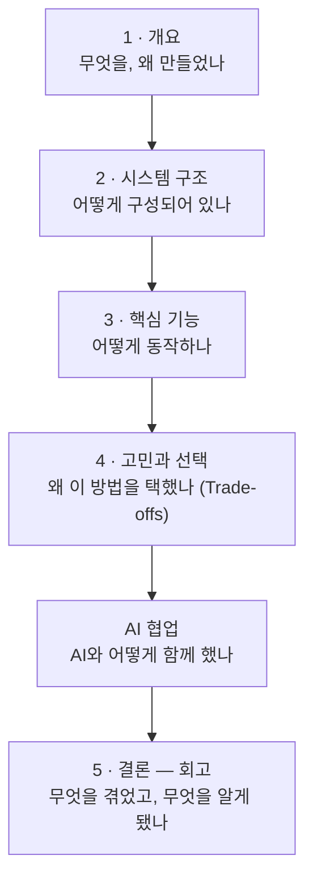
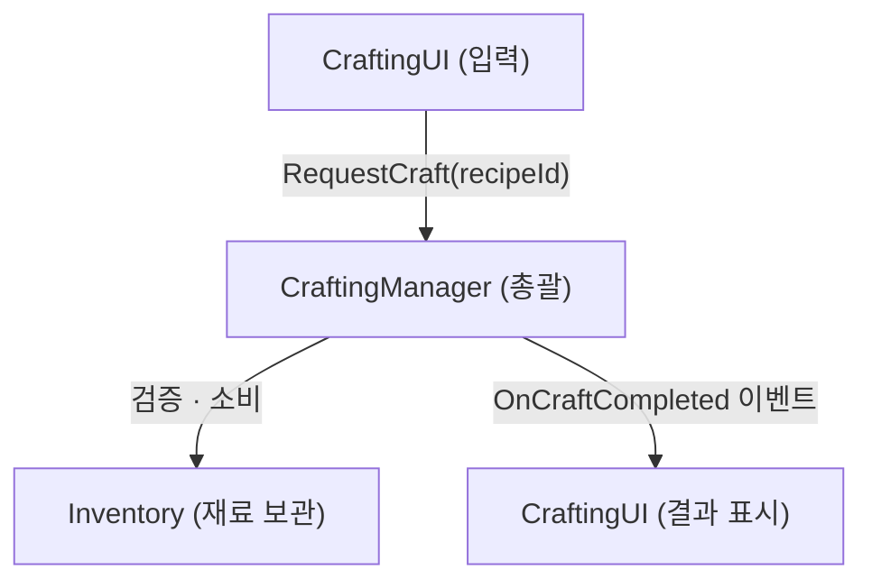
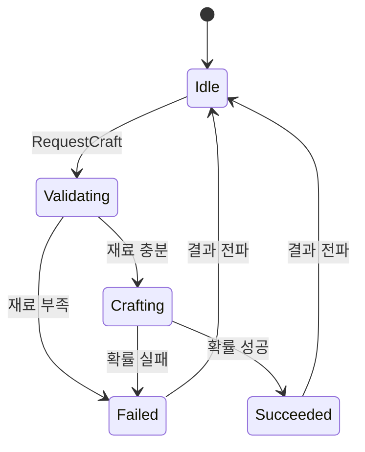
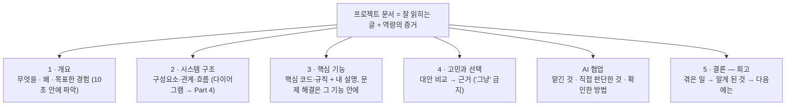

# Part 2. 프로젝트 문서 작성 가이드

이 파트는 여러분이 만든 프로젝트를 **다른 사람(면접관, 동료, 미래의 나)** 에게
명확하게 설명하는 문서, **프로젝트 문서**를 쓰는 가이드입니다. (예전 이름: 기술 문서)

## 프로젝트 문서란?

프로젝트를 **만든 뒤에** 쓰는, **채용 담당자가 읽는** 문서입니다.
무엇을 만들었는지보다 **무엇을 왜 그렇게 정했는지**(고민과 선택)가 본체입니다.

| 문서 | 언제 쓰나 | 누가 읽나 | 담는 것 |
|---|---|---|---|
| 기획서 | 만들기 전 | 같이 만드는 사람 | 무엇을 만들 것인가 |
| 리포의 README | 만드는 중 | 코드를 받아 실행할 사람 | 실행 방법, 폴더 구조 |
| **프로젝트 문서** | **만든 뒤** | **채용 담당자 · 면접관** | **무엇을 왜 그렇게 정했고, 어떻게 확인했나** |

담는 판단은 구현이든, 게임 디자인(규칙·밸런스·레벨)이든, 일정이든 상관없습니다.
**지원 직군(프로그래머·디자이너)을 가르지 않습니다.** 같은 뼈대 위에 내가 내린 판단을 싣습니다.

목적은 두 가지입니다.

- **지식의 명시화** — 머릿속에만 있는 로직과 설계 의도를, 글·다이어그램·코드·플레이 화면으로
  누구나 열람 가능한 형태로 구체화합니다.
- **소통의 매개체** — 서로 다른 배경지식을 가진 사람(개발자 ↔ 개발자, 개발자 ↔ 비개발자)에게
  작동 원리와 판단을 정확히 전달합니다.

> 핵심은 하나입니다. **`잘 읽히는 문서`** + **`역량을 드러내는 문서`**.
> 기능만 잔뜩 나열한 문서는 읽는 사람에게 시간 낭비에 가깝습니다.

> **역량은 어디에서 드러날까요?** 동작하는 코드와 매끄러운 문장은 이제 AI가 빠르게 만들어 줍니다.
> 그래서 프로젝트 문서가 보여줘야 하는 것은 **설명**에 더해 **판단**(무엇을 문제로 보았고 무엇을 버렸나)과
> **검증**(맞는지 어떻게 확인했나)입니다. 이 파트의 뼈대는 모두 이 세 가지를 드러내기 위한 틀입니다.

> 기획서를 그대로 옮기거나 기능을 나열한 문서는 프로젝트 문서가 아닙니다.
> 기능 목록은 "만들었다"만 말하고, 판단과 검증을 말하지 않기 때문입니다.

## 읽는 사람이 찾는 답

읽는 사람은 **내용**과 **구조**, 두 축으로 봅니다. 이 파트의 각 절은 아래 질문 하나씩에 답합니다.

| 축 | # | 읽는 사람의 질문 | 문서의 어디에 |
|---|---|---|---|
| 내용 | 1 | 무엇을 만들었고 왜 만들었나 | 1 · 개요 |
| 내용 | 2 | 어떤 경험을 목표로 했고, 그것은 어떻게 됐나 | 1 · 개요(목표한 경험) + 5 · 결론 |
| 내용 | 3 | 핵심 기능은 무엇이고 어떻게 만들었나 — 게임 디자인으로 설명해도, 코드로 설명해도 됨 | 2 · 3 (기능 단위) |
| 내용 | 4 | 무엇을 고민했고, 어떤 대안 중 무엇을 골랐나 | 4 · 고민과 선택 |
| 내용 | 5 | AI와 어떻게 협업했고 무엇을 겪었나 | AI 협업 |
| 내용 | 6 | 이 프로젝트에서 무엇을 겪었고 무엇을 알게 됐나 | 5 · 결론 — 회고 |
| 구조 | 1 | 개요가 비개발 직군에게도 읽히는가 | 읽히는 문서의 구조 |
| 구조 | 2 | 장이 제목 + 내용으로 짜여 있고, 소제목이 바로 읽히는가 | 읽히는 문서의 구조 |
| 구조 | 3 | 같은 내용을 반복하지 않는가 | 읽히는 문서의 구조 |

## 프로젝트 문서의 5단 구조 — 뼈대 + 선택 모듈

취업용 프로젝트 문서는 아래 논리 흐름을 뼈대로 삼습니다.



유형을 고르지 않습니다. **모든 문서가 갖는 뼈대**에, **조건이 맞을 때만 모듈**을 붙입니다.

### 뼈대 — 모든 문서에 공통

5단은 네 덩어리로 읽습니다. 덩어리마다 읽는 사람의 질문 하나에 답합니다.

| 덩어리 | 단계 | 읽는 사람의 질문 |
|---|---|---|
| **개요** | 1 | 이게 무엇이고, 이 사람이 무엇을 했나 |
| **기능 단위** | 2 · 3 · 4 (구조 · 기능 · 고민과 선택) | 어떻게 만들었고, 왜 그렇게 했나 |
| **AI 협업** | (번호 없음, 결론 앞) | AI와 어떻게 일했나 |
| **결론** | 5 | 그래서 어땠나, 무엇을 알게 됐나 |

- **기능 단위는 기능 수만큼 반복**합니다. 기능이 하나면 1 → 2 → 3 → 4 → 5를 한 번,
  여러 개면 개요 → (기능별로 구조·기능·고민과 선택 반복) → 결론입니다.
  공통 구조 장 하나 뒤에 기능별 장이 이어지는 형태도 같은 뼈대입니다.
- **기능 단위는 두 종류**입니다. 섞어도 되고 한 종류만 있어도 됩니다. 단위마다 그 종류의 기준으로 봅니다.

  | 단위 종류 | 무엇 | 2 · 구조 | 3 · 기능 | 4 · 고민과 선택 |
  |---|---|---|---|---|
  | **구현 단위** | 코드로 만든 시스템·기능 | 아키텍처 다이어그램, 클래스의 역할 분담 | 핵심 코드와 본인의 설명 | 공통 |
  | **기획 단위** | 설계한 규칙·밸런스·레벨 | 규칙·수치의 관계(표·그림) | 플레이에서 보이는 모습(화면·영상)과 본인의 설명 | 공통 |

- 👍 기능이 많으면 **대안이 있었던 기능 2~4개**만 깊게 쓰고, 나머지는 표 한 줄로 정리합니다.
  선택이 없었던 기능은 깊게 쓸 내용이 없습니다.
- 👎 모든 기능을 같은 깊이로 반복해 **기능 목록**이 된 문서.
- 5단의 단계 이름은 **점검하는 틀의 이름**입니다. 문서의 제목으로 그대로 쓸 필요가 없습니다
  (→ 아래 "읽히는 문서의 구조"). "고민과 선택"이 각 기능 안에 흩어져 있어도 같은 역할을 하면 됩니다.

### 선택 모듈 — 조건이 맞을 때만 붙임

| 모듈 | 붙이는 조건 | 어디에 | 붙는 내용 |
|---|---|---|---|
| **[팀]** | 개발 인원이 2명 이상 — **조건이 맞으면 필수** | 개요 뒤 | 팀·역할 소개 → 담당 파트 개요 |
| **[기획]** | 무엇을 만들지를 **본인이 정했고**, 그 판단을 싣는다 — 선택 | 개요 뒤 ([팀]보다 앞) | 플레이 소개 → 코어 루프 |
| **[일정]** | 계획을 세우고 중간에 바꾼 기록이 있다 — 선택 | 결론 안 | 계획 대비 실제 · 범위를 줄인 결정 |

```
개요 (목표한 경험 포함)
 └ [기획] 플레이 소개 → 코어 루프
 └ [팀]   팀·역할 소개 → 담당 파트 개요
기능 단위 (기능 수만큼 반복)
AI 협업
결론 — 회고
 └ [일정] 계획 대비 실제 · 범위를 줄인 결정
```

- [기획]과 [팀]을 둘 다 붙이면 **[기획]이 먼저**입니다. 게임이 무엇인지 알아야 그 안에서 담당 파트의 위치가 이해됩니다.
- 남이 정한 기획을 구현만 했다면 [기획]을 붙이지 않습니다. 안 붙인 [기획]·[일정]은 빠진 것이 아닙니다.
- 모듈은 짧게 씁니다 — [팀] 반 화면, [기획] 한 화면, [일정] 표 하나 안팎. 어느 조합에서든 문서의 본체는 **기능 단위**입니다.
- 모듈별로 무엇을 쓰는지는 결론 다음의 **"선택 모듈 쓰는 법"** 에 있습니다.

> 늘 말하지만 **법칙이 아닙니다.** 목적에 부합하는 구조와 내용을 담는 것이 중요합니다.

### 작성 도구 팁

- 문서 툴은 무엇이든 무방하나, **텍스트 소스는 Markdown으로 먼저** 쓰기를 권장합니다.
- 최종 출력은 **PDF가 가능한 플랫폼**을 고르세요. (기업 보안 정책상 외부 링크가 막힌 곳이 있습니다.)
- 이 가이드는 이후 Markdown → Mermaid(Part 4) → 레이아웃·슬라이드(Part 3) 흐름으로 이어집니다.

> **이 파트의 관통 예제**: 각 섹션의 **핵심 워크스루 예시**는 **크래프팅 시스템**
> (재료를 소비해 아이템을 제작하는 시스템)으로 통일합니다. Part 4~6에서 같은 예제로
> 다이어그램과 프롬프트를 다루므로, 여기서 흐름을 익혀 두면 자연스럽게 연결됩니다.
> 크래프팅 예시는 기능 하나짜리 **가장 짧은 뼈대**입니다. 전체 목차는 이 파트 끝의 "예시를 한 편으로 이어 보면"에 있습니다.
> (개념 이해를 돕는 👎/👍 대비 예시는 오브젝트 풀링·인벤토리 등 상황에 맞는 다른 사례도 씁니다.)

---

## 1. 개요: 무엇을, 왜 설명하나요?

문서의 **결론부터** 제시하는 곳입니다. 읽는 사람이 **10초 안에 핵심을 파악**할 수 있어야 합니다.
(비유: 게임의 퀘스트 로그 — "무엇을 해야 하는지" 한 줄로 보여주는 것)

### 들어갈 내용

- **무엇을 만들었는지와 왜 만들었는지** — 어떤 문제·목적이 있었는가. 절을 나누지 말고 **개요의 글 안에서** 읽히게 씁니다.
- **목표한 경험** — 이 프로젝트로 유저가 무엇을 느끼거나 할 수 있기를 바랐는지 **한 문장**
- **개발 환경** — 엔진 버전, 도구, 기간, 인원
- **링크** — 시연 영상, GitHub 등

> 개요는 **게임 개발을 모르는 사람도** 읽을 수 있어야 합니다. 전문 용어는 빼거나 풀어 씁니다.
> 서류를 처음 여는 사람이 인사 담당자일 수도 있습니다.

### 개념 더 깊이: 독자를 위한 '지도'와 '나침반'

개발자는 자신이 무엇을 만들었는지 잘 알지만, 문서를 읽는 사람은 **아무런 배경지식이 없습니다.**
개요는 이 정보의 비대칭을 해소하고 독자를 **'같은 출발선'** 에 세우는 과정입니다.

- **무엇을 — '지도':** 독자에게 지금부터 탐험할 영역(범위)을 보여줍니다.
  *"이 문서는 게임 전체가 아니라, 그중 '캐릭터 상태 이상 시스템'만 다룹니다."* 처럼요.
- **왜 — '나침반':** 왜 이 지도를 펼쳐야 하는지 방향과 목적을 가리킵니다.
  이 문서가 해결하려는 **'문제'** 와 제공하는 **'가치'** 를 명확히 짚어야 합니다.
- **목표한 경험 — '목적지':** 이 여정이 끝났을 때 유저가 무엇을 느끼기를 바랐는지입니다.
  결론에서 "목적지에 닿았는가"를 돌아볼 기준이 됩니다.

> 읽는 사람에게 배경지식을 깔아 주는 작업입니다. 이 부분에서 읽는 사람의 흥미가 생기면 Best.

### 목표한 경험: 장르 이름이 아니라 유저가 느낄 것

| 👎 아쉬운 예 | 👍 좋은 예 |
|---|---|
| "퍼즐 게임" · "로그라이크 액션" (장르 이름) | "쫓기는 긴장 속에서 한 수 앞을 읽는 재미" |
| "인벤토리·제작·강화 시스템 구현" (기능 목록) | "실패해도 재료의 절반은 남아, 다시 도전할 마음이 드는 제작" |

- 게임이 아닌 시스템·툴이면 '유저'는 그것을 쓰는 사람(플레이어나 다른 개발자)입니다.
  (예: "레시피를 추가하는 사람은 화면 코드를 건드리지 않고 데이터만 넣으면 된다")
- 왜 만들었는지를 쓴 글이 이미 이 내용을 담고 있으면, 따로 한 줄을 더 쓰지 않아도 됩니다.

### 👎 아쉬운 예 / 👍 좋은 예

**👎 아쉬운 개요 — '왜'가 없다**

```
본 문서는 Unity 프로젝트의 인벤토리 시스템에 대해 설명합니다.
C#의 List<Item>를 사용하여 아이템을 추가, 삭제, 사용하는 기능을 구현했습니다.
```

- **문제점:** 그래서 '왜' 만들었나요? 기존에 인벤토리가 없었나요? `List`를 고른 특별한 이유가 있나요?
  독자는 이 기능의 **필요성이나 중요도**를 전혀 알 수 없습니다. ("게임 로딩이 느린 것 같아서 고쳤습니다"도
  마찬가지 — '느린 것 같다'는 주관적이고, '개선했다'는 모호합니다.)

**👎 틀의 이름이 드러난 개요**

```
### 1.1 무엇을 만들었나 (What)
오브젝트 풀링을 도입했습니다.

### 1.2 왜 만들었나 (Why)
보스전에서 프레임이 떨어졌습니다.
```

- **문제점:** "What", "Why"는 문서를 **점검하는 틀의 이름**입니다. 제목·소제목·문단 머리 라벨로 쓰면
  빈칸을 채운 양식처럼 보여 글이 서툴러 보입니다. 내용은 맞아도 읽는 맛이 없습니다.

**👍 좋은 개요 — 무엇을·왜·증거가 글 안에서 이어진다 ('오브젝트 풀링' 최적화)**

```
모바일 슈팅 게임의 총알을 미리 만들어 두고 재사용하는 '오브젝트 풀링(Object Pooling)'을
도입해, 보스전의 프레임 드랍을 없앤 작업입니다.

기존에는 총알(Bullet)이 발사될 때마다 Instantiate()(생성)하고, 화면을 벗어나면
Destroy()(파괴)했습니다. 초당 100개 이상의 총알이 나오는 보스전에서 이 방식이
GC(가비지 컬렉터) 스파이크를 일으켰고, 테스트 기기(Galaxy S10)에서 초당 10~15프레임이
떨어졌습니다.

목표는 탄막이 가장 많은 순간에도 플레이어가 끊김 없이 피하는 손맛을 느끼는 것이었습니다.
```

- **좋은 이유:** ① **무엇을** 만들었는지("오브젝트 풀링 도입") ② **왜** 만들었는지("GC 스파이크·프레임 드랍")
  ③ **구체적 증거**("초당 100개", "10~15프레임") — 문제를 누구나 공감하게 함 ④ **목표한 경험**("끊김 없이 피하는 손맛")이
  소제목 없이 한 흐름의 글로 읽힙니다.

### 예시: 크래프팅 시스템 개요

> 유니티(C#) 생존 게임에 들어가는 **아이템 제작(크래프팅) 시스템**입니다.
> 플레이어가 가진 재료를 써서, 레시피에 정해진 결과물을 **확률적으로** 만듭니다.
>
> - 예시 레시피: **나무 x3 + 돌 x2 → 돌도끼 x1** (성공 확률 80%)
> - 제작에 실패하면 재료를 **50%만** 소비합니다.
>
> 처음에는 제작 규칙을 처리하는 코드가 화면(UI) 코드 안에 섞여 있었습니다. 그래서 **새 레시피를 추가할 때마다 화면 코드를 고쳐야** 했고,
> 확률과 실패 처리가 맞게 동작하는지 **테스트하기 어려웠습니다.** 이 문제를 풀려고 **제작 로직을 UI에서 떼어 내고**, 결과는 **이벤트로 알리는** 구조로 다시 만들었습니다.
>
> 목표는 두 가지였습니다. 레시피를 추가하는 사람은 화면 코드를 건드리지 않고 **데이터만 넣으면** 되고,
> 플레이어는 제작에 실패해도 **재료의 절반은 지킬 수** 있어야 합니다.

개발 환경과 링크는 문서 맨 위에 표로 둡니다.

| 항목 | 내용 |
|---|---|
| 장르 | 생존 게임의 제작(크래프팅) 시스템 |
| 개발 기간 | 2025.06 ~ 2025.07 (개인 프로젝트) |
| 개발 인원 | 1인 |
| 개발 환경 | Unity 2022.3 LTS (C# 10), Rider |
| 주요 기술 | 이벤트 기반 아키텍처 · 인터페이스 의존(DIP) · LINQ · 확률 판정 주입 |
| 링크 | GitHub `https://github.com/<아이디>/<레포>` · 시연 영상 `https://youtu.be/<영상 ID>` |

> 링크는 **실제 주소**를 적습니다. `[GitHub](#)`처럼 비워 둔 자리표시자는 읽는 사람에게 "링크 없음"과 같습니다.

### 팁

- **무엇을과 왜를 모두 담되, 소제목으로 나누지 마세요.** 한 문단 안에 함께 있어도 됩니다.
  특히 **왜(문제 상황)** 가 없으면 나머지 문서 전체가 "그래서 왜 만들었는데?"라는 질문에 답하지 못합니다.
- **개요는 맨 마지막에 다시 쓰세요.** 문서를 다 쓰고 나면 하려던 이야기가 훨씬 명확해집니다.
  초안은 처음에 쓰더라도, **최종 개요는 모든 작성이 끝난 뒤 퇴고**하는 것이 가장 좋습니다.
- **스스로 "So What?"(그래서 뭐?)을 반복하세요.** "인벤토리를 만들었다" → "그래서?" →
  "아이템을 저장해야 하니까" → "그래서?" → "그래야 플레이어가 성장·모험을 이어가니까!"
  이렇게 표면적인 '무엇을'에서 **근본적인 '왜'** 로 내려갑니다. 마지막 답이 곧 **목표한 경험**입니다.
- **'문제'를 측정 가능하게 정의하세요.** "느리다" 대신 "로딩에 15초 걸린다", "아이템 쓰려면
  5번 클릭해야 한다"처럼. 이 구체적인 문제가 곧 '왜'가 됩니다.

---

## 2. 시스템 구조: 어떻게 구성되어 있나요?

전체 그림을 먼저 보여주어 독자가 **길을 잃지 않게** 하는 섹션입니다.
단순히 "사용한 기술 목록"을 나열하는 것이 아닙니다. 아래 세 가지를 정의합니다.

- **구성요소 (Components)** — 시스템을 이루는 큰 모듈이나 클래스
- **관계 (Relationships)** — 한 구성요소가 다른 것을 '알고' 있는지, '제어'하는지,
  '데이터를 받기'만 하는지 등의 책임
- **흐름 (Flow)** — 입력(Input)이 어떤 구성요소를 거쳐 어떤 결과(Output)로 이어지는지의 순서

> **다이어그램을 적극 활용하세요.** 클래스 다이어그램·시퀀스 다이어그램 등으로 사고 과정을
> 시각화합니다. 작성법은 **Part 4(Mermaid)** 에서 다룹니다.
> (Mermaid·PlantUML 등은 AI에게 코드 생성을 요청하면 잘 만들어 줍니다 → Part 5)

### 들어갈 내용

- **아키텍처 다이어그램** — 구성요소 간 데이터/명령의 흐름
- **핵심 클래스 역할 분담** — 각 클래스가 무슨 책임을 지는가
- **왜 이렇게 나눴는지** — 한두 줄이라도
- (기획 단위라면) 위 대신 **규칙·수치의 관계**를 표나 그림으로, 그리고 왜 그렇게 짰는지
  (예: 레벨별 적 체력·보상의 관계표, 스킬 쿨타임과 피해량의 곡선)

### 비유: 레스토랑 주방 시스템

여러분의 프로젝트를 **하나의 레스토랑**이라고 생각해 봅시다. 손님이 "스테이크 주세요"라고
주문(Input)하고 스테이크를 받는(Output) 과정은 이렇습니다.

| 역할 | 프로그램 대응 | 하는 일 (그리고 하지 않는 일) |
|---|---|---|
| **손님** | User | 주문을 한다 |
| **웨이터** | View / UI | 주문을 받아 '주방'에 전달. **요리(Logic)는 할 줄 모른다** |
| **주방장** | Controller / Manager | 주문을 받고 요리사에게 지시. **직접 요리하지 않고 지시·조율만** |
| **요리사** | Logic / Service | 냉장고에서 재료를 가져와 레시피대로 요리 |
| **냉장고** | Model / Data | 재료(데이터)를 보관만 한다 |

여기서 '시스템 구조'란 **"웨이터는 주방장에게만, 주방장은 요리사에게만, 요리사는 냉장고에만
접근한다"** 는 **규칙과 흐름**을 정의한 '업무 분장표'입니다. 이 구조가 없다면 손님이 직접 냉장고를
뒤지거나(보안 문제), 요리사가 주문받으러 홀에 나가는(유지보수 재앙) 혼란이 생깁니다.

### 👎 아쉬운 예 / 👍 좋은 예 (인벤토리 시스템)

**👎 구조가 없는 '갓(God) 클래스'**

> `Player.cs` 스크립트 하나에 모든 것을 구현했습니다. `Update()` 안에서 'I' 키를 누르면 인벤토리
> UI를 켜고, 클릭을 감지해 아이템을 사용하고, `List<Item>`에 추가/삭제하며, `PlayerPrefs`로 저장까지 합니다.

- **문제점:** 이것은 '레스토랑'이 아니라 **'푸드트럭'** 입니다. 사장(`Player.cs`) 혼자 주문·요리·서빙·계산을
  다 합니다. 당장은 빨라도, "UI를 클릭에서 드래그로 변경"하려면 '요리' 로직과 '저장' 로직이
  얽힌 코드를 건드려야 해서 100% 버그가 납니다.

**👍 역할과 흐름이 명확한 구조 (관심사 3분리)**

> UI(View)·데이터(Model)·관리(Controller)로 분리했습니다.
> - **`InventoryUI` (웨이터):** 창을 켜고 끄며 슬롯을 표시. 클릭되면 직접 처리하지 않고 Manager에게 "3번 슬롯 클릭됨"만 **알린다.**
> - **`Inventory` (냉장고):** 아이템 데이터(`List<ItemData>`)를 **보관만** 한다. `Update()`도, UI 코드도 없다.
> - **`InventoryManager` (주방장):** 둘 사이의 **중재자.** "3번 클릭됨"을 받으면 데이터를 확인하고 로직을 실행한 뒤, UI에 "아이콘 비워라"라고 **지시**한다.
>
> `[클릭]` → `[InventoryUI]` → `[InventoryManager]` → `[Inventory]` → (처리 후) → `[InventoryUI 갱신]`

- **좋은 이유:** 각 클래스의 **책임이 명확**합니다. UI 디자인을 통째로 바꿔도 `InventoryUI`만
  수정하면 되고, Manager·Inventory 코드는 한 줄도 건드릴 필요가 없습니다. 이것이 **유지보수성**입니다.

### 예시: 크래프팅 시스템 구조

**2.1 요청과 결과의 흐름**



UI는 **요청만** 보내고, 결과는 **이벤트로** 돌려받습니다. 화살표가 UI → Manager 한 방향뿐이라는 점이 핵심입니다.

**2.2 클래스 관계** — **Part 4**의 클래스 다이어그램을 그대로 씁니다(여기서는 생략).

**2.3 클래스마다 맡은 일**

| 클래스 / 인터페이스 | 역할 |
|---|---|
| `ICraftingService` | 제작 서비스의 계약(인터페이스). UI는 구현체가 아닌 **이 계약에 의존** |
| `CraftingManager` | 제작 총괄. 검증 → 확률 판정 → 소비 → 결과 이벤트 발행 |
| `Inventory` | 재료 보관·검증·소비·추가 (LINQ로 재료 조회) |
| `Recipe` | 레시피 데이터 (필요 재료, 결과물, 성공 확률) |
| `CraftingUI` | 사용자 입력 → 제작 요청, 이벤트 구독 → 결과 표시 |

`CraftingUI`가 `CraftingManager`를 직접 참조하지 않고 `ICraftingService`에 의존하게 한 이유는,
UI를 건드리지 않고도 제작 로직 구현을 **교체·테스트**할 수 있게 하기 위해서입니다(DIP).
근거는 4장에서 다룹니다.

### 팁

- **코드로 말하지 말고, 그림으로 말하세요.** 이 섹션의 핵심은 '코드'가 아닙니다. 박스와
  화살표로 그린 다이어그램이 코드 100줄보다 낫습니다. **"누가 누구에게 명령하는가?"** 를
  화살표로 그리는 연습을 하세요.
- **다이어그램은 "요약"입니다.** 모든 클래스를 다 그리지 마세요. 독자가 전체 구조를
  이해하는 데 필요한 핵심 구성요소만 남깁니다.
- **"왜 이렇게 나눴는지"를 설명하세요.** 단순히 "MVC 패턴을 썼습니다"는 의미가 없습니다.
  *왜* MVC가 필요했는지(예: "UI 변경이 잦을 것 같아 로직과 분리")를 한두 줄만 덧붙여도,
  다음 섹션(고민과 선택)으로 자연스럽게 이어집니다.
- **Tech Stack은 '도구'일 뿐입니다.** 기술을 나열하는 건 '내가 가진 망치와 못'을 보여주는 것일 뿐.
  '어떻게 집을 지었는지'는 그 도구로 세운 **골조(설계도)** 를 보여줘야 드러납니다.

---

## 3. 핵심 기능: 어떻게 동작하나요?

시스템이 **실제로 어떻게 작동하는지**를 구체적인 코드(또는 규칙·수치)와 설명으로 보여주는 섹션입니다.
2절('시스템 구조')이 건물의 **설계도**였다면, 이 섹션은 설계도대로 지었다는 **시공 기록**입니다.

### 핵심 동작: 핵심만 고르고, 내 말로 설명한다

- 설계가 실제 코드로 어떻게 구현되었는지 **'증거'** 를 제시합니다.
  단, **모든 코드(1000줄)를 보여주는 것은 최악**입니다. 독자가 "아하!" 하고 깨닫는
  **핵심 로직**만 선별합니다. 잘 설명하면 코드를 안 보여줘도 됩니다.
  (기준은 **읽는 상세 문서에서 한 블록 50줄 안팎**, **슬라이드 한 장면에는 20줄 안팎**입니다.
  슬라이드에 더 길게 넣어야 하면 장면을 나누세요.)
- 코드에는 반드시 **본인의 설명**을 붙입니다. 왜 이 순서·이 구조인지.
- 👍 다른 코드가 이 기능을 **어떻게 쓰는지**(무엇을 호출하면 무엇이 나오는지)가 보이면 읽는 사람이 더 빨리 이해합니다.
- **기획 단위**라면 코드 대신 **플레이에서 보이는 모습**(화면·영상)과 **왜 이 규칙·이 수치인지**를 설명합니다.

### 비유: 에어프라이어 설명서

'스마트 인벤토리'라는 최신 에어프라이어를 만들었다고 해봅시다.

- **👎 모든 회로도 첨부:** 50페이지짜리 전기 회로도(`InventoryManager.cs` 500줄 전체)를 붙입니다.
  → (독자: *"그래서 어떻게 켜요? 감자튀김은 몇 도에 돌려요?"*)
- **👎 설명 부족:** *"전원 버튼 누르면 요리가 잘 됩니다."* → (독자: *"전원 버튼이 어디죠? '요리'가 뭘 하죠?"*)
- **👍 좋은 설명서:** **핵심 동작 원리**('튀김'은 초고온 열풍 순환 로직)를 짚고, 필요하면
  **빠른 사용법**(전원 → 모드 '튀김' → 시작)을 곁들입니다.

### 👎 아쉬운 예 / 👍 좋은 예 (인벤토리 UseItem)

**👎 코드만 나열** — "`InventoryManager.cs` 코드는 다음과 같습니다" → 500줄 전체 붙여넣기.

- **문제점:** 독자에게 '해석'의 부담을 전부 떠넘깁니다. 어디가 중요한지, 왜 이렇게 짰는지 아무 정보가 없습니다.
  (회로도를 그냥 던진 꼴)

**👍 핵심 로직 + 내 설명**

> `UseItem()`은 ① Model에서 아이템을 조회하고 → ② 타입을 **`switch`로 검사**해 → ③ 타입별
> 로직(체력 회복/장비 장착)을 실행한 뒤 → ④ 아이템을 제거합니다. 외부(`InventoryUI`)에서는 `UseItem(slotIndex)` 하나만 호출합니다.
> `if`가 아니라 `switch`를 쓴 것은 나중에 '재료'·'퀘스트' 등 **새 타입이 추가돼도 쉽게
> 확장**하기 위해서입니다. `item == null`, 알 수 없는 타입(`default:`) 같은 **예외 처리**도 함께 보여줍니다.

### 예시: 크래프팅 '제작 요청' 기능

이 기능의 장 제목은 틀의 이름("3. 핵심 기능")이 아니라 내용의 이름(**"3. 제작 요청"**)입니다.

**3.1 요청하고 결과 받기**

외부(예: `CraftingUI`)에서는 인터페이스의 `RequestCraft` 하나만 호출하면 됩니다. 결과는 이벤트를 구독해 받습니다.

```csharp
// CraftingUI.cs — 제작 서비스에 '요청'만 하고, 결과는 이벤트로 받는다
public sealed class CraftingUI : MonoBehaviour
{
    private ICraftingService crafting; // (Why) 구현체가 아닌 인터페이스에 의존 (DIP)

    private void OnEnable() =>
        crafting.OnCraftCompleted += HandleResult;

    private void OnDisable() =>
        crafting.OnCraftCompleted -= HandleResult;

    // 버튼 클릭 시 호출
    public void OnCraftButtonClicked(string recipeId) =>
        crafting.RequestCraft(recipeId);

    private void HandleResult(CraftingResult result) =>
        toast.Show(result.IsSuccess ? $"{result.Item.Name} 제작 성공!" : result.Reason);
}
```

**3.2 제작 한 번의 흐름**

`RequestCraft`는 이 시스템의 심장부입니다.

1. 레시피를 조회한다 (LINQ)
2. **소비 전에** 재료를 검증한다 (방어적 처리)
3. 확률을 판정한다 (주입된 `roll`로 테스트 가능)
4. 성공/실패에 따라 소비율을 달리하고, 결과를 이벤트로 발행한다



```csharp
public void RequestCraft(string recipeId)
{
    var recipe = FindRecipe(recipeId);            // LINQ: FirstOrDefault
    if (recipe == null)
    {
        Publish(CraftingResult.Fail(recipeId, "레시피를 찾을 수 없습니다."));
        return;
    }

    // (Why) 소비 전에 먼저 검증 → 재료 유실 없이 안전하게 중단
    if (!inventory.HasIngredients(recipe.Ingredients))
    {
        Publish(CraftingResult.Fail(recipeId, "재료가 부족합니다."));
        return;
    }

    // (Why) 확률 판정을 주입된 roll로 분리 → 테스트 시 결정론적 검증 가능
    var success = roll() < recipe.SuccessRate;

    // (Why) 성공 100% / 실패 50% 소비로 '실패 페널티' 규칙을 표현
    inventory.Consume(recipe.Ingredients, success ? 1.0f : 0.5f);
    if (success)
        inventory.Add(recipe.Result);

    Publish(success
        ? CraftingResult.Success(recipeId, recipe.Result)
        : CraftingResult.Fail(recipeId, "제작에 실패했습니다."));
}
```

> 코드 안의 `// (Why)` 주석은 **코드에 이유를 남기는 습관**의 예입니다. 문서의 제목·소제목에는 "Why"를 쓰지 않습니다.

**3.3 실패해도 재료가 전부 사라지던 문제**

문제 해결 사례는 그 문제가 생긴 **기능의 장 안에** 씁니다. 문제 → 원인 → 해결 → 달라진 점 순서입니다.

| 항목 | 내용 |
|---|---|
| 문제 | 제작 실패 시에도 재료가 100% 사라짐 |
| 원인 | 확률 판정 결과와 무관하게 소비율을 `1.0f` 고정으로 넘기고 있었음 |
| 해결 | `success ? 1.0f : 0.5f`로 소비율을 분기하고, 이 규칙을 테스트로 고정 |
| 결과 | 실패 페널티(50% 소비) 규칙이 의도대로 동작, 회귀 방지 |

### 팁

1. **코드를 '설명'하세요 (제일 중요).** 주석이든 텍스트 박스든, *"왜 소비보다 검증을
   먼저 했는지", "왜 `roll`을 주입했는지"* 등 **자신의 생각을 서술**하세요.
   코드가 **무엇을 하는지**는 읽으면 보입니다. 설명할 것은 **왜 이 구조인지, 무엇을 버렸는지,
   어디서 깨졌는지**입니다. "이 함수는 재료를 소비합니다" 같은 문장은 설명이 아니라 코드의 반복입니다.
2. **예외 상황을 보여주세요.** 성공 케이스뿐 아니라 "레시피가 없다면?", "재료가 부족하면?"
   같은 방어 코드를 보여주는 것은 매우 전문적인 태도입니다.
3. **쓰는 쪽도 보여주면 좋습니다.** "이 기능을 쓰려면 이 함수만 알면 됩니다"(위 3.1)가 있으면
   읽는 사람이 구조를 더 빨리 잡습니다. 필수는 아닙니다.
4. **문제 해결은 그 기능 옆에.** 버그·난관은 결론에 모아 두지 말고, 그 문제가 생긴 기능의 장 안에
   문제 → 원인 → 해결 → 결과로 씁니다. 읽는 사람이 맥락을 잃지 않습니다.

> 이 섹션의 목적은 *"코드를 짤 줄 안다"* 가 아니라 *"내 코드를 남에게 설명할 줄 안다"* 를
> 보여주는 것입니다. 코드를 설명할 줄 안다 = **개발 커뮤니케이션이 가능하다** =
> *함께 일할 수 있겠다.* 면접에서 프로젝트 문서로 질문하는 회사가 좋은 회사인 이유입니다.

---

## 4. 고민과 선택 (Trade-offs): 왜 이 방법을 선택했나요?

이 섹션은 **"왜 다른 방법이 아닌 이 방법을 선택했는가?"** 에 대한 논리적 변론입니다.
정답을 맞히는 게 아니라, 여러 대안 사이에서 **최선을 고르기 위해 얼마나 깊이 고민했는지**를
증명합니다. 만든 사람의 **판단력**과 **잠재력**이 드러나는 곳입니다.

> 코드를 따라 치는 사람(Coder)과 스스로 문제를 해결하는 개발자(Developer)를 가르는 기준점.

### 들어갈 내용

- **대안 2개 이상을 비교** (비교 표 권장)
- 상황(기간·규모·팀)을 근거로 한 **선택 이유**
- 고른 쪽이 치른 **대가**와, 그것을 어떻게 감당했는지

### 핵심: '정답'이 아닌 '최선'의 근거

모든 상황에 완벽한 만능 기술은 없습니다. 모든 선택에는 **Trade-off(대가)** 가 따릅니다.

- 어떤 기술은 (A) 쓰기 쉽지만 (B) 성능이 느립니다.
- 어떤 기술은 (A) 성능은 좋지만 (B) 배우기 어렵고 시간이 오래 걸립니다.
- 어떤 규칙은 (A) 긴장감을 주지만 (B) 초보 플레이어를 일찍 떠나게 합니다.

내 기능과 상황(예: "개발 기간이 1주일")을 고려해, **"왜 A의 장점을 취하고 B의 단점을
감수했는지"** 그 의사결정 과정을 기록합니다. 이것은 *"검색 첫 답을 복붙한 게 아니라, 여러
대안을 비교하고 의식적으로 선택했다"* 는 가장 강력한 증거입니다.

### 비유: 전사의 무기 선택

RPG 속 '전사'가 보스를 잡으러 가기 전 무기를 고른다고 해봅시다.

> **[상황]** 내 캐릭터는 힘은 약하지만 **민첩이 높다.**  **[적]** 보스는 방어력은 낮지만 **공격 속도가 빠르다.**
> - **[대안 A] 양손 도끼:** (+) 강력한 한 방 데미지 / (−) 느린 속도 — 보스의 빠른 공격을 못 피함
> - **[대안 B] 쌍검:** (+) 빠른 공격 속도 — 피하며 여러 번 침 / (−) 낮은 한 방 데미지
> - **[결정]** 내 '민첩'이 높고 보스가 '빠르니', '한 방 데미지'를 포기(**Trade-off**)하고 **쌍검**을 택한다.

'양손 도끼'가 나쁜 무기인가요? 아닙니다. 그저 **'이 상황'에 맞지 않을 뿐**입니다. 기술 선택도, 규칙 설계도 똑같습니다.
이 섹션은 "왜 쌍검을 골랐는지" 그 **근거**를 설명하는 곳입니다. (자소서의 경험 서술도 완전히 같은 구조입니다.)

### 👎 아쉬운 예 / 👍 좋은 예 (최고 점수 저장 방식)

**👎 '고민'이 없다** — "`PlayerPrefs`를 사용해서 최고 점수를 저장했습니다."

- **문제점:** 왜 `PlayerPrefs`였나요? 유일한 방법이었나요? 다른 건 안 알아봤나요? (= "그냥 도끼를 들었다")

**👍 Trade-off가 명확**

> **[대안 A] `PlayerPrefs`** — (+) 한 줄이면 끝·구현 빠름 / (−) 키-값만 저장, 복잡한 데이터 부적합, **치팅 취약**
> **[대안 B] JSON 파일** — (+) 객체를 통째로 저장(인벤토리·퀘스트 등에 유리) / (−) File I/O를 직접 구현해 복잡
>
> **[결정] `PlayerPrefs`를 선택.** 이 프로젝트는 간단한 2D 슈팅으로 저장할 게 '최고 점수' 하나뿐이었습니다.
> '치팅 취약성'이라는 대가는 있었지만, 복잡한 데이터가 없어 JSON의 유연함은 **과한 설계(Over-engineering)**
> 라고 판단했습니다. → **'유연성'을 포기하는 대신 '빠른 개발 속도'** 를 택하는 것이 합리적이라 결론지었습니다.

### 예시: 크래프팅 — "4. 제작 결과를 어떻게 알릴 것인가"

장 제목을 **결정해야 했던 질문**으로 지으면, 제목만 읽어도 무엇을 고민했는지 보입니다.

| | 대안 A. Manager가 UI를 직접 갱신 | 대안 B. `OnCraftCompleted` 이벤트 발행 |
|---|---|---|
| 장점 | 구현이 직관적이고 빠름. 흐름 추적이 쉬움 | Manager는 "결과가 나왔다"만 알림 → **느슨한 결합**. 구독자만 추가하면 됨 |
| 단점 | Manager가 UI를 알게 되어 **강하게 결합**. 결과를 쓰는 곳이 늘 때마다 Manager 수정 | 이벤트 흐름이 코드에 직접 안 보여 추적이 조금 어려움. 구독 해제 누락 시 누수 위험 |

**대안 B(이벤트)를 선택했습니다.** 제작 결과를 소비할 대상이 UI 하나로 끝나지 않고
(연출·사운드·업적 등) 늘어날 것으로 판단했기 때문입니다.
'이벤트 흐름 추적의 어려움'이라는 대가는, `OnEnable/OnDisable`에서 구독·해제를 **짝지어 관리하는 규칙**으로 상쇄했습니다.

### 팁

1. **"그냥"이라는 단어를 금지하세요.** "그냥 이벤트 썼어요", "그냥 검색에 나와서요"는
   고민하지 않았다는 고백입니다. 모든 선택에는 이유가 있어야 합니다.
2. **면접관이 가장 보고 싶어 하는 부분입니다.** 신입에게 엄청난 기술력을 기대하진 않습니다.
   '문제를 어떻게 접근하는지', '스스로 합리적 결정을 내리는지'를 봅니다.
3. **틀려도 괜찮습니다.** 중요한 건 정답이 아니라 *"A와 B를 비교했고, 이러이러한 이유로
   A가 낫다고 판단했다"* 는 **판단의 근거**를 제시하는 태도입니다.
4. **AI가 제안한 방법도 대안의 하나입니다.** AI가 준 구조를 그대로 받았다면 왜 받아들였는지,
   고치거나 버렸다면 왜 그랬는지를 대안 비교에 함께 올리세요. "AI가 그렇게 써 줘서"는 "그냥"과 같은 말입니다.
5. **팀 프로젝트라면** 인터페이스 합의·병합 충돌처럼 **협업에서 생긴 문제**도 좋은 고민거리입니다.

> 널 채용하려는 사람도 같이 일할 사람입니다. 채용 프로세스도 그 사람처럼 사고한다는 걸 명심하세요.

---

## AI 협업: AI와 어떻게 함께 했나요?

결론 바로 앞에 두는 절입니다. 번호를 붙이지 않습니다.
요즘 채용은 AI를 썼는지가 아니라 **어떻게 시키고 어떻게 걸렀는지**를 봅니다(→ Part 1 §3 "요즘 채용이 보는 것").

### 들어갈 내용

| 적을 것 | 물음 |
|---|---|
| **협업 방식** | AI에게 무엇을 맡겼고, 무엇을 **내가 직접 판단**했나 |
| **확인 방법** | AI가 낸 결과를 어떻게 확인했나 (읽고 이해함 · 테스트 · 플레이로 확인 등) |
| **경험** | 무엇이 잘 됐고, 무엇이 안 됐나 — 회고와 같은 기준으로 구체적으로 |

- **AI를 쓰지 않았다면** "쓰지 않았다"는 한 줄이면 됩니다.
- 앞 장에서 이미 쓴 일(예: AI가 낸 코드에서 생긴 버그)은 여기서 다시 풀지 말고 **"(3.3 참고)"처럼 가리키기만** 합니다.
- 개발할 때 AI를 쓴 경험을 적는 요령과 예시는 **Part 5-6**에 더 있습니다.

### 👎 아쉬운 예 / 👍 좋은 예

**👎 확인할 수 없는 문장**

> AI를 적극 활용해 개발 효율을 높였습니다. 사용 도구: AI 챗봇, AI 코딩 도구.

- **문제점:** 무엇을 맡겼는지, 결과가 맞았는지 알 수 없습니다. 어느 프로젝트 문서에 붙여도 말이 되는 **일반론**입니다.
  선택 이유가 "AI가 그렇게 짜 줘서"인 문서도 같습니다.

### 예시: 크래프팅 — "5. AI와 일한 방식"

| | 내용 |
|---|---|
| 맡긴 것 | 확률 성공·실패 경로의 단위 테스트 초안 |
| 직접 판단한 것 | 결과를 이벤트로 알린다는 결정(4장), 실패하면 재료를 50%만 소비한다는 규칙 |
| 확인한 방법 | AI가 쓴 테스트를 한 줄씩 읽고, `roll`에 고정값을 넣어 성공·실패 경로를 직접 실행 |

- **잘 된 것**: 테스트 초안을 빨리 얻어, 소비율 문제(3.3)를 고친 직후에 회귀 테스트를 바로 붙일 수 있었습니다.
- **안 된 것**: AI가 처음 제안한 구조는 Manager가 UI를 직접 갱신하는 방식(4장의 대안 A)이었습니다.
  결과를 쓰는 곳이 앞으로 늘어난다는 사정은 AI가 알 수 없었기 때문에, 이 결정은 직접 내려야 했습니다.

> 적은 내용은 **면접에서 그대로 질문받습니다.** 실제로 한 일만, 확인할 수 있게 적으세요.

---

## 5. 결론 — 회고: 무엇을 겪었고, 무엇을 알게 됐나요?

단순히 "다 만들었다"고 선언하는 곳이 아닙니다. 형식은 자유이고, **개인이 느낀 회고**가 본체입니다.
아래 세 가지가 읽히면 됩니다.

- **무엇을 겪었는가** — 문서 앞에서 다룬 결정·사건
- **거기서 무엇을 알게 됐는가**
- **다음에는 무엇을 다르게 할 것인가**

그리고 개요의 짝을 맞춥니다.

- **목표한 경험은 어떻게 됐는가** — 개요에서 세운 목표를 돌아봅니다. 확인하지 못했으면 **못 했다고** 밝힙니다.
- 유저 피드백 · 측정값(예: "로딩 15초 → 3초") · 개선할 사항은 회고의 **근거로 쓰는 선택 항목**입니다.
  수치를 쓴다면 **어떻게 확인했는지**(테스트, 로그, 프로파일러, 플레이테스트)를 붙이세요. 확인한 방법이 없는 결과는 주장일 뿐입니다.

### 판정 질문: 다른 문서에 붙여도 말이 되는가?

> **"이 문장을 다른 프로젝트 문서에 그대로 붙여도 말이 되는가?"** 말이 되면 일반론입니다. 다시 쓰세요.

| 👎 일반론 | 👍 이 프로젝트에서만 쓸 수 있는 문장 |
|---|---|
| "협업의 중요성을 느꼈다." · "많이 배웠다." | "씬 파일 병합 충돌이 마감 주에 몰렸다. 다음에는 씬을 담당자별로 나누고 시작하겠다." |
| "확장성을 더 고려해야겠다." | "레시피를 코드에 적어 둔 탓에 기획자가 직접 고칠 수 없었다. 다음에는 `ScriptableObject` 데이터로 시작하겠다." |

### 비유: 원정대 보고서

미지의 정글을 탐험한 '원정대' 리더가 되었다고 해봅시다.

> - **목적지(목표한 경험):** 목표했던 '황금 유적'을 발견. 좌표 확보·유물 3점 채취로 확인.
> - **겪은 일:** A지점에서 대원이 독사에 물려 3일 지체.
> - **알게 된 것:** '해독제'인 줄 알았던 약이 '소화제'였음 — **출발 전 물품명을 확인(테스트)하지 않은 실수.**
>   C지점의 무너진 다리는 '임시 밧줄'로 겨우 건넜음.
> - **다음에는:** 출발 전 물품 목록을 점검하고, '튼튼한 목재 다리'를 설계할 자재를 챙길 것.

이 보고서가 없다면 다음 탐험대도 똑같이 독사에 물리고 무너진 다리에서 위험에 처합니다.
'알게 된 것'을 기록하는 것은 **반복되는 재앙을 막는** 가장 중요한 엔지니어링 활동입니다.

### 👎 아쉬운 예 / 👍 좋은 예 (오브젝트 풀링 회고)

**👎 결과만 있다** — "오브젝트 풀링을 적용해 `Instantiate`를 제거했습니다. 이제 보스전에서 렉이 안 걸립니다. 많이 배웠습니다."

- **문제점:** "렉이 안 걸린다"는 주관적이고, "많이 배웠다"는 어느 문서에 붙여도 말이 됩니다. (= "유적 찾았다. 끝.")

**👍 목표 돌아보기 + 겪은 일 → 알게 된 것 → 다음에는**

> **목표는 이뤘습니다.** 보스전 총알 100개 구간이 60fps → 15fps로 떨어지던 것이, 적용 후 같은 구간에서
> 평균 58~60fps를 유지했습니다(프로파일러로 확인). 다만 "끊김 없이 피하는 손맛"을 플레이어가 느꼈는지는 직접 확인하지 못했습니다.
>
> - **재사용하는 물건은 돌려받을 때 초기화 책임이 누구에게 있는지 정해야 했습니다.** 반납된 총알이 이상한 방향으로
>   날아가던 문제(기능 장의 문제 해결 사례)는 속도를 초기화하지 않아서였습니다. 다음에는 풀에 넣는 대상의 인터페이스에 초기화를 처음부터 넣겠습니다.
> - **풀을 총알 전용으로 만들어, 이펙트 풀은 같은 스크립트를 복사해야 했습니다.** 다음에는 제네릭 `PoolManager<T>`로 시작하겠습니다.

### 예시: 크래프팅 — "6. 회고"

> **목표는 절반만 이뤘습니다.** 새 레시피를 추가할 때 화면 코드 수정은 **0줄**이 됐고, `roll`을 주입할 수 있게 해 확률 성공·실패 경로를 **단위 테스트로 검증**할 수 있게 됐습니다.
> 하지만 `Recipe`가 코드에 하드코딩되어 있어, "데이터만 넣으면 된다"는 프로그래머에게만 해당합니다. 기획자는 여전히 직접 고칠 수 없습니다.
> 플레이어 쪽 목표(실패해도 재료의 절반은 지킴)는 테스트로 확인했지만, 실제 플레이어가 이 규칙을 어떻게 받아들이는지는 확인하지 못했습니다.
>
> - **규칙이 값 하나에만 있으면 틀려도 드러나지 않았습니다.** 실패해도 재료가 전부 사라지던 문제(3.3)는 소비율 `1.0f` 하나 때문이었습니다.
>   다음에는 규칙을 정하는 시점에 그 규칙의 테스트부터 쓰겠습니다.
> - **로직은 분리했지만 데이터는 분리하지 못했습니다.** 레시피를 코드에 적어 둔 탓에 기획자가 직접 수정할 수 없습니다.
>   다음에는 `ScriptableObject` 기반 데이터로 시작해, 코드 없이 레시피를 편집·밸런싱할 수 있게 하겠습니다.

### 팁

- **주관적 표현을 지우세요.** "렉이 안 걸린다"가 아니라 "60fps 유지(프로파일러 확인)"처럼
  **측정값**으로 증명합니다. 방법을 댈 수 없는 수치는 싣지 않습니다.
- **아쉬운 점을 쓰는 것은 약점이 아닙니다.** 한계를 인지하고 다음 방향을 제시하는 것은
  오히려 **성숙한 태도**의 증거입니다.
- **앞 장을 가리키세요.** 회고에서 문제 해결 과정을 다시 풀지 말고 "(3.3)"처럼 가리키고, 거기서 **알게 된 것**만 씁니다.

---

## 선택 모듈 쓰는 법

뼈대에 붙이는 모듈입니다. **모듈은 절을 더할 뿐 아니라 뼈대를 쓰는 방식도 바꿉니다.**

### [팀] — 개발 인원 2명 이상이면 필수

- 팀 구성과 **내 역할·담당 범위**를 분리해 적습니다. 이것이 없으면 읽는 사람은 무엇이 내 것인지 알 수 없습니다.
- **담당 파트 개요**: 전체에서 내 파트가 어디인지 보여줍니다. (전체 구조 그림에 내 파트를 표시하면 빠릅니다.)
- 기능 단위는 **내가 만든 부분만** 다루고, 팀원이 만든 부분은 다루지 않음을 밝힙니다.
- 결론에서 **팀의 결과와 내 기여**를 구분합니다.
- 👍 협업에서 생긴 문제(인터페이스 합의·병합 충돌 등)를 고민과 선택에 씁니다.

### [기획] — 무엇을 만들지를 내가 정했을 때 (선택)

목표한 경험(개요)과 그 돌아보기(결론)는 뼈대에 있습니다. [기획]은 그 사이를 잇는 부분입니다.

- **플레이 소개**: 한 판이 어떻게 흘러가는지 실제 플레이 화면(영상·GIF·스크린샷)으로 보여줍니다.
- **코어 루프**: 플레이어가 반복하는 행동을 그림이나 한 줄 흐름으로 적고(예: 탐색 → 수집 → 제작 → 강화),
  그 반복이 **목표한 경험을 어떻게 만드는지** 설명합니다.
- 기능 단위마다 그 기능이 **목표한 경험(또는 코어 루프의 어느 행동)에 어떻게 기여하는지** 한 줄을 붙입니다.
- 👎 목표한 경험과 기능이 따로 노는 문서 — 앞에서 경험을 말하고 뒤에서는 한 번도 돌아오지 않습니다.

### [일정] — 계획을 바꾼 기록이 있을 때 (선택, 결론 안)

- **계획 대비 실제**: 단계(마일스톤)마다 계획과 실제를 표로 나란히 둡니다.
- **범위를 줄인 결정**: 무엇을 · 언제 · 왜 뺐는지 밝힙니다.
- 👎 일정표 그림만 있고 판단이 없는 문서.

---

## 읽히는 문서의 구조

내용과 따로, **읽히는 문서인지**를 봅니다.

### ① 개요가 비개발 직군에게도 읽힌다

전문 용어가 없거나 풀어 썼고, 게임 개발을 모르는 사람도 무엇을 만들었는지 압니다.

### ② 장이 제목 + 내용으로 짜여 있고, 소제목이 바로 읽힌다

- **틀의 이름을 붙이지 않습니다** — "What", "Why", "기능 A", "사용법 -", "핵심 기능 -" 같은 분류 라벨을 뺍니다.
  5단의 단계 이름("핵심 기능", "고민과 선택")도 점검하는 틀의 이름이지 제목이 아닙니다.
- 구현 용어 대신 **읽는 사람이 보는 것**으로 씁니다.
- 수식어를 덜어 **짧게** 씁니다.
- 제목 아래에는 반드시 내용이 있고, 제목 없이 긴 내용이 이어지지도 않습니다.

| 👎 | 👍 |
|---|---|
| 1.1 무엇을 만들었나 (What) · 1.2 왜 만들었나 (Why) | (소제목 없이 개요 글 안에 풀어 씀) |
| 2. 기능 A - 물리 기반 염동력 | 2. 기능 - 염동력 |
| 2.2 사용법 - 조작 입력과 물체 상태 | 2.2 조작과 물체 상태 |
| 2.3 핵심 기능 - 화면 중심 기반 타겟 선택 | 2.3 조준과 선택 |
| 3. 핵심 기능 · 4. 고민과 선택 | 3. 제작 요청 · 4. 제작 결과를 어떻게 알릴 것인가 |

> 슬라이드의 장과 목차는 보통 문서의 제목에서 만들어집니다. 제목이 읽히면 슬라이드 목차도 읽힙니다.

### ③ 같은 내용을 반복하지 않는다

한 내용은 **한 곳에** 쓰고, 다른 곳에서는 "(3.3 참고)"처럼 **가리키기만** 합니다.
개요에서 다음 장들을 미리 요약하는 '예고편'도 필요 없습니다 — 목차와 제목이 그 일을 합니다.

---

## AI가 대신 써 줄 수 없는 내용

AI에게 "프로젝트 문서를 써 줘"라고 하면 그럴듯한 문서가 나옵니다. 그런데 그 문서에는 **여러분만 아는 일**이 없습니다.
아래 내용은 직접 겪은 사람만 쓸 수 있고, 읽는 사람이 가장 오래 머무는 부분입니다.

| 내용 | 어디에 | 예 (크래프팅) |
|---|---|---|
| **되돌린 결정** — 처음에 무엇을 골랐고 왜 바꿨나 | 4. 고민과 선택 | 처음에는 Manager가 UI를 직접 갱신했다가, 사운드를 붙이면서 이벤트로 바꿈 |
| **해 보고 바꾼 것** — 플레이해 보거나 피드백을 받고 고친 것 | 3. 핵심 기능 · 5. 결론 | 실패 시 재료 전부 소실 → 테스트 플레이에서 좌절감이 커서 50% 소비로 변경 |
| **포기한 것** — 기간·인원 때문에 뺀 기능과 그 순서 | 4. 고민과 선택 · [일정] | 레시피 편집 도구는 빼고, 확률 판정 테스트를 먼저 완성 |
| **조율한 것** — 팀에서 인터페이스·범위를 맞춘 과정 | 4. 고민과 선택 ([팀]) | 인벤토리 담당과 `HasIngredients`의 반환 형식을 합의 |
| **지금 구조의 한계** — 알고 있지만 고치지 못한 것 | 5. 결론 | 레시피가 코드에 하드코딩되어 기획자가 직접 수정 불가 |

일반론인지는 결론에서 쓴 판정 질문 하나로 가립니다 — 그 문장을 **다른 프로젝트 문서에 옮겨도 말이 되면** 일반론입니다.

| 👎 일반론 | 👍 이 프로젝트에서만 쓸 수 있는 문장 |
|---|---|
| "확장성과 유지보수성을 고려해 설계했습니다." | "새 레시피를 추가할 때 UI 코드를 고치지 않도록, 제작 로직을 `CraftingManager`로 옮겼습니다." |
| "성능을 최적화했습니다." | "레시피 조회를 매 프레임 하던 것을 요청 시점 1회로 줄였습니다. (프로파일러로 확인)" |

---

## 있으면 좋은 항목 (필수는 아닙니다)

뼈대에 꼭 들어가야 하는 것은 아니지만, 게임 프로젝트 문서에서 **있으면 읽는 사람이 더 빨리 이해하는** 항목입니다.
제목이 같을 필요는 없습니다 — **내용이 있으면** 있는 것으로 봅니다.

| 항목 | 어디에 | 무엇을 |
|---|---|---|
| **레퍼런스** | 1. 개요 | 참고한 게임·작품과, 내 프로젝트가 **그것과 다른 점** |
| **조작법** | 1. 개요 또는 3. 핵심 기능 | 키·버튼과 그 결과. 시연 영상·스크린샷을 읽는 데 필요한 만큼만 |
| **As-Is / To-Be 비교** | 4. 고민과 선택 · 5. 결론 | 바꾸기 전과 뒤를 **표로 나란히** (수치가 있으면 수치로) |

> 없다고 감점되는 항목이 아닙니다. 있으면 개요가 더 빨리 읽히고, 회고가 더 구체적으로 보입니다.
> (플레이어가 반복하는 흐름, 곧 **코어 루프**는 [기획] 모듈에서 다룹니다.)

---

## 예시를 한 편으로 이어 보면

크래프팅 예시를 한 편의 프로젝트 문서로 이으면 목차는 이렇습니다. 장 제목이 틀의 이름이 아니라 **내용의 이름**입니다.

| 문서의 장 | 뼈대의 어디 |
|---|---|
| 제목 · 한 줄 소개 · 개요 표 | (문서 머리) |
| 1. 개요 | 1 · 개요 (무엇을 · 왜 · 목표한 경험) |
| 2. 구조 — 2.1 요청과 결과의 흐름 · 2.2 클래스 관계 · 2.3 클래스마다 맡은 일 | 2 · 시스템 구조 |
| 3. 제작 요청 — 3.1 요청하고 결과 받기 · 3.2 제작 한 번의 흐름 · 3.3 실패해도 재료가 전부 사라지던 문제 | 3 · 핵심 기능 (+ 문제 해결 사례) |
| 4. 제작 결과를 어떻게 알릴 것인가 | 4 · 고민과 선택 |
| 5. AI와 일한 방식 | AI 협업 |
| 6. 회고 | 5 · 결론 — 회고 |

혼자 만든 기능 하나짜리라 모듈은 붙이지 않았습니다(**뼈대**). 팀 프로젝트였다면 개요 뒤에 [팀]이 붙습니다.

---

## Part 2 정리



- 유형을 고르지 않습니다. **뼈대 + 해당하는 모듈**([팀]은 필수, [기획]·[일정]은 선택)입니다.
- 기능 단위는 **구현 단위**(코드)든 **기획 단위**(규칙·밸런스·레벨)든 됩니다. 직군을 가르지 않습니다.
- 묘사 수단은 항목에 따라 다릅니다 — 글이 나을 때도, 다이어그램이 나을 때도, 코드가 나을 때도 있습니다.
- 제목은 **내용의 이름**으로, 한 내용은 **한 곳에만** 씁니다.
- 뼈대가 드러내려는 것은 **설명 · 판단 · 검증**입니다. 되돌린 결정, 해 보고 바꾼 것, 포기한 것처럼
  **직접 겪은 사람만 쓸 수 있는 내용**에 지면을 쓰세요.
- 다음 파트부터는 이 문서를 **어떻게 보여줄지**(레이아웃·다이어그램)와
  **어떻게 빠르게 만들지**(AI)를 다룹니다.
