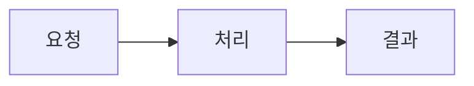
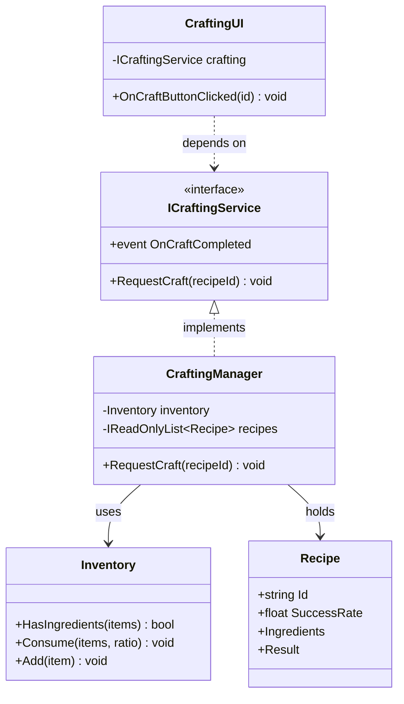
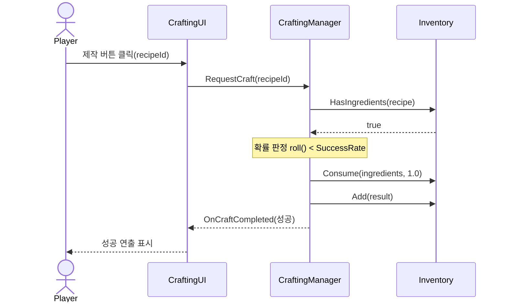
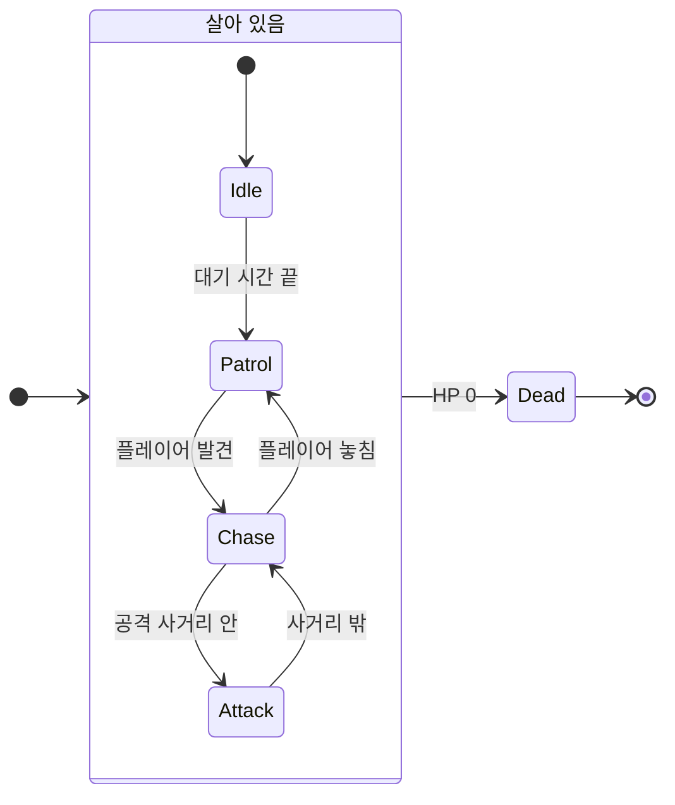
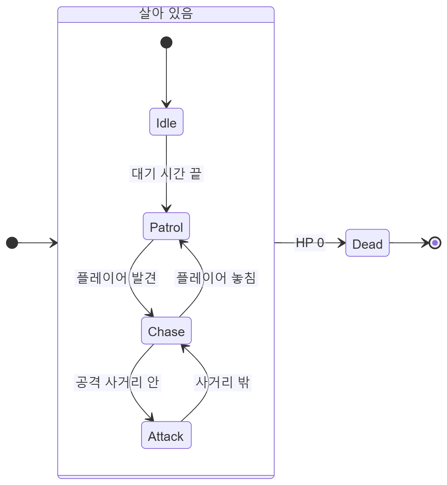
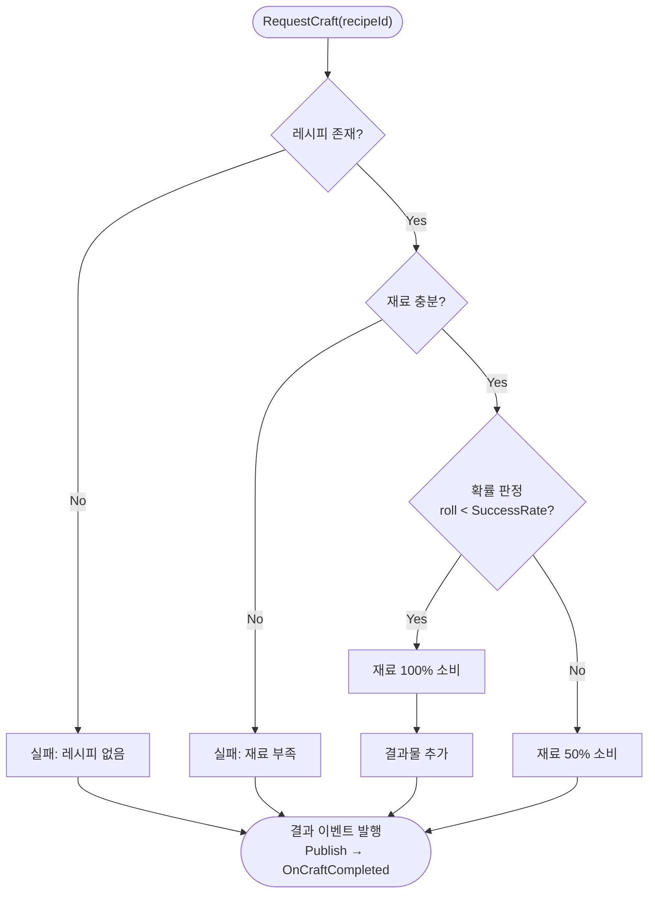
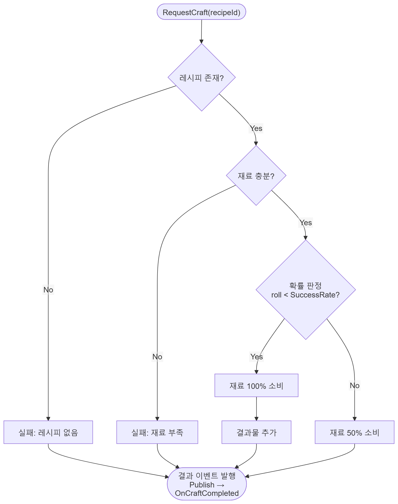
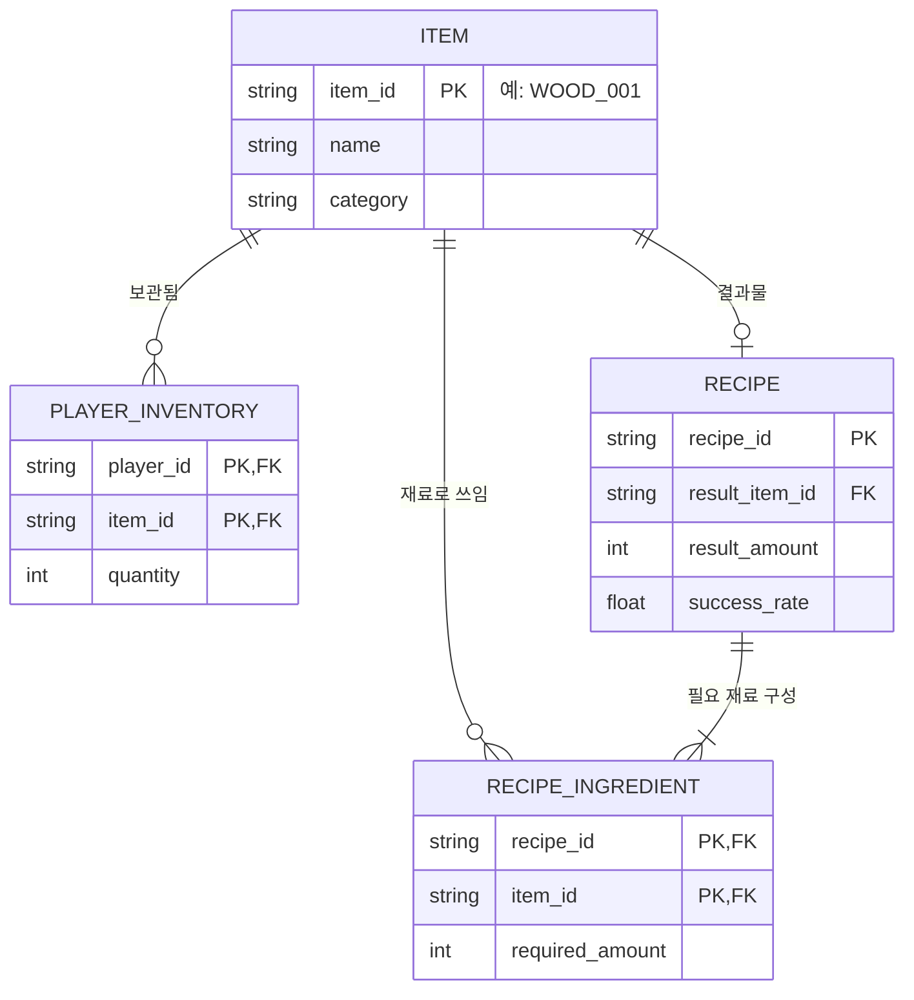

# Part 4. Mermaid 다이어그램 작성법

프로젝트 문서의 **시스템 구조**(Part 2)를 가장 잘 전달하는 도구가 다이어그램입니다.
이 파트는 **Mermaid**로 5종 다이어그램을 그리는 법을 다룹니다.

> **이 파트의 전제**: 문법을 처음부터 외우지 않습니다. **AI에게 시켜서 만들고,
> 여러분은 "읽고 고칠 수 있으면" 충분합니다.** 그래서 각 다이어그램은
> *① 언제 쓰나 → ② 완성본(코드+그림) → ③ 읽는 법 → ④ AI에게 시키는 법* 순으로 봅니다.
> 실제 프롬프트는 Part 6에 모아 두었습니다.

> **종류는 습관이 아니라 '그 절이 설명하는 것'으로 고릅니다.** 데이터 구조를 플로우차트로, 클래스를 차례로
> 타고 들어가는 호출을 플로우차트로 그리는 일이 흔합니다. 각 절의 "언제 쓰나"에 **코드에서 보이는 신호**를 적어 두었고,
> 한눈에 비교하는 표는 **4-7**, 흔히 잘못 고르는 경우는 **4-8**에 있습니다.

## 4-1. Mermaid란?

**텍스트(코드)로 쓰면 그림이 되는** 다이어그램 도구입니다.

- 코드라서 **Git으로 버전 관리**가 되고, 수정이 그림 편집보다 빠릅니다.
- **GitHub가 네이티브로 렌더링**합니다. ` ```mermaid ` 코드 블록을 쓰면 Repo에서 그림으로 보입니다.
- **AI가 잘 만들어 줍니다.** "이런 관계를 클래스 다이어그램으로 그려줘"라고 하면 코드가 나옵니다.

### GitHub에서 렌더링되는 원리

아래처럼 코드 블록의 언어를 `mermaid`로 지정하면 됩니다.

````markdown

````

> **주의**: GitHub **Repo**(README 등)에서는 위 방식이 자동 렌더링됩니다.
> 하지만 **GitHub Pages(github.io)** 나 **Marp 슬라이드**에서는 추가 설정이나
> 이미지 변환이 필요합니다. 이 변환 과정은 **Part 5(AI 워크플로우)** 에서 다룹니다.

---

## 4-2. 클래스 다이어그램 (Class Diagram)

### 언제 쓰나

**시스템 구조** 섹션의 핵심. 클래스 사이의 **상속·인터페이스 구현**, 또는 **핵심 협력 관계**
(누가 누구를 가지고, 누구의 메서드를 부르나)를 보여줍니다.

- **코드에서 보이는 신호**: `: Base`, `: IInterface`, `abstract`·`override`, 다른 클래스를 필드로 들고 그 메서드를 부르는 곳.
- **한 그림에 한 목적.** 클래스 다이어그램은 둘 중 하나를 보이는 그림입니다.
  - **상속 구조 그림** — 상속·구현 관계(`<|--`, `<|..`)에 있는 클래스**만** 넣습니다. 필드나 인자로 참조만 하는
    클래스가 섞이면 "무엇이 무엇을 물려받는가"라는 그림의 뜻이 흐려집니다.
  - **협력 그림** — 핵심 클래스(10개 안팎)와 그 사이의 사용·의존(`-->`, `..>`)을 넣습니다.
    인터페이스에 기대는 구조(DIP)를 보이려면 그 인터페이스의 구현 관계(`<|..`) 하나는 함께 둡니다.
  - 둘 다 보여야 하면 **그림을 둘로** 나눕니다.
- 메서드 없이 **필드만 있는 데이터 클래스**가 대부분이라면 클래스 다이어그램이 아니라 **ER 다이어그램(4-6)** 입니다.

### 완성본 — 크래프팅 시스템 클래스 관계 (협력 그림)

상속은 없고, UI가 구현체가 아니라 인터페이스에 기댄다는 점(DIP)을 보이려고 구현 관계 하나(`<|..`)만 함께 둔 **협력 그림**입니다.




### 읽는 법 (관계 기호만 알면 됨)

| 기호 | 의미 | 이 그림에서 |
|---|---|---|
| `<|..` | 인터페이스 **구현** | `CraftingManager`가 `ICraftingService`를 구현 |
| `-->` | **사용/소유** | `CraftingManager`가 `Inventory`를 사용 |
| `..>` | **의존** | `CraftingUI`가 인터페이스에 의존 (구현체 아님 → DIP) |
| `+ / -` | public / private | `+RequestCraft`는 외부 공개, `-inventory`는 내부 |

> **핵심 포인트 하나**: `CraftingUI`가 `CraftingManager`(실선)가 아니라
> `ICraftingService`(점선, 인터페이스)에 연결된 것 — 이게 **느슨한 결합**의 증거입니다.
> 면접관은 이 점선 하나에서 "SOLID를 이해하는구나"를 읽습니다.

### AI에게 시키는 법 (요약)

> "다음 C# 클래스들의 관계를 Mermaid 클래스 다이어그램으로 그려줘.
> CraftingManager는 ICraftingService를 구현하고, Inventory를 사용하며…"

→ 전체 프롬프트는 **Part 6-3**에 있습니다.

---

## 4-3. 시퀀스 다이어그램 (Sequence Diagram)

### 언제 쓰나

**주체가 둘 이상**(클래스·객체·서버/클라이언트)이고, 그들이 **차례로 부르는 호출 흐름**을 보일 때.
"버튼을 누르면 → 누가 누구를 부르고 → 어떤 순서로 결과가 돌아오는가"를 전달할 때 최적입니다.
참여자는 클래스(객체)·서버·클라이언트, 화살표는 메서드 호출·메시지입니다.

- **코드에서 보이는 신호**: 한 메서드 안에서 다른 클래스의 메서드를 부르고, 그 안에서 또 다른 클래스를 부름
  (`A.Do()` → `B.Run()` → …). 이벤트(`event`·`Action`) 구독과 호출, 콜백·`await`, 서버↔클라이언트 메시지(RPC).
- 클래스의 함수를 **타고 타고 들어가는** 흐름은 플로우차트가 아니라 시퀀스입니다.
  반대로 **한 주체 안**의 갈림길(`if`/`else`)은 플로우차트(4-5)입니다.
- 호출 흐름 안에 갈림길이 있으면 시퀀스의 `alt` 블록으로 쓰거나, 그 메서드 하나만 플로우차트로 따로 그립니다.

### 완성본 — 제작 요청 성공 흐름




### 읽는 법

| 기호 | 의미 |
|---|---|
| `->>` | 실선 화살표 = **요청/호출** (동기 메시지) |
| `-->>` | 점선 화살표 = **응답/반환** 또는 이벤트 |
| `Note over` | 특정 참여자 위의 **부연 설명** (여기선 확률 판정) |

> **핵심 포인트**: `Mgr-->>UI`가 이벤트(`OnCraftCompleted`)라는 점.
> Manager가 UI를 직접 호출하지 않고 "결과가 나왔다"고 알리기만 합니다(관찰자 패턴).
> 클래스 다이어그램의 점선과 시퀀스의 이벤트가 **같은 설계 의도**를 다른 각도로 보여줍니다.

### AI에게 시키는 법 (요약)

> "다음 처리 순서를 Mermaid 시퀀스 다이어그램으로. 참여자는 Player, CraftingUI,
> CraftingManager, Inventory. 결과 전파는 이벤트라 점선으로…"
> → 전체 프롬프트는 **Part 6-3**.

---

## 4-4. 상태 다이어그램 / FSM (State Diagram)

### 언제 쓰나

**상태를 가진 시스템**을 설명할 때. 게임에서는 특히 자주 씁니다 —
몬스터·캐릭터 AI, 게임 페이즈, 턴 진행처럼 **값으로 남는 상태**가 있고 조건에 따라 그 값이 바뀌는 곳.
"어떤 상태들이 있고, 무슨 조건으로 전이되는가"를 전달합니다.

- **코드에서 보이는 신호**: 상태 `enum`(또는 상태 필드)과 **그 값을 바꾸는 코드(전이)**,
  상태 클래스(`IState`의 `Enter`/`Exit`), 턴 단계, Animator 상태·트리거.
- 종류를 나누기만 하는 `enum`(효과 종류·방향·블록 색)은 상태가 아닙니다. 값이 **바뀌는** 코드가 있어야 상태입니다.
- 코드에 상태 값이 없고 상태 이름이 **한 메서드 안의 검사 단계**(조기 `return`)일 뿐이라면, 상태 다이어그램이 아니라 플로우차트(4-5)입니다.

> **이 절만 크래프팅 예제가 아닌 이유**: 크래프팅의 `RequestCraft`는 한 번 호출로 끝나는 **검사 순서**라서
> 값으로 남는 상태가 없습니다. 그래서 크래프팅은 플로우차트(4-5)로 설명하고, 상태 다이어그램은
> 상태가 실제로 있는 **몬스터 AI**로 봅니다.

### 완성본 — 몬스터 AI 상태 전이

먼저 코드입니다. 상태가 `enum`으로 있고, 그 값을 바꾸는 곳(`ChangeState`)이 있습니다. 이것이 상태 다이어그램을 쓸 신호입니다.

```csharp
public enum MonsterState { Idle, Patrol, Chase, Attack, Dead }

public sealed class MonsterAI : MonoBehaviour
{
    private MonsterState state = MonsterState.Idle;

    private void Update()
    {
        if (state == MonsterState.Dead) return;
        if (hp <= 0) { ChangeState(MonsterState.Dead); return; }

        switch (state)
        {
            case MonsterState.Idle   when idleTimer.IsDone:   ChangeState(MonsterState.Patrol); break;
            case MonsterState.Patrol when CanSeePlayer():     ChangeState(MonsterState.Chase);  break;
            case MonsterState.Chase  when InAttackRange():    ChangeState(MonsterState.Attack); break;
            case MonsterState.Chase  when LostPlayer():       ChangeState(MonsterState.Patrol); break;
            case MonsterState.Attack when !InAttackRange():   ChangeState(MonsterState.Chase);  break;
        }
    }

    // 전이는 이 한 곳에서만 — 상태가 바뀔 때 할 일(애니메이션 등)을 모으기 쉽다
    private void ChangeState(MonsterState next) => state = next;
}
```

코드의 `ChangeState` 호출 하나가 그림의 화살표 하나입니다.





### 읽는 법

| 기호 | 의미 |
|---|---|
| `[*]` | 시작(진입) / 종료 지점 |
| `-->` | 상태 전이 |
| `: 텍스트` | 전이 **조건/트리거** (플레이어 발견, HP 0 등) |
| `state "이름" as X { }` | **묶은 상태** — 안의 어느 상태에서든 밖으로 나가는 전이를 한 번에 그림 |

> **핵심 포인트**: `Attack → Chase`, `Chase → Patrol`처럼 **되돌아가는 화살표**가 상태 다이어그램의 특징입니다.
> 같은 상태로 몇 번이고 돌아오는 흐름을 플로우차트로 그리면 갈림길이 끝없이 반복되지만, 상태 다이어그램은 한 장에 담깁니다.
> 그리고 "HP가 0이 되면 무엇을 하던 중이든 `Dead`"라는 규칙을 **묶은 상태**에서 나가는 화살표 하나로 보입니다.

### AI에게 시키는 법 (요약)

> "다음 MonsterAI 코드의 상태 전이를 Mermaid stateDiagram으로. 상태는 MonsterState enum의 Idle, Patrol,
> Chase, Attack, Dead이고, 전이는 ChangeState를 부르는 조건마다 하나씩. HP 0으로 Dead가 되는 전이는
> 살아 있는 상태들을 묶어서 한 번만…"
> → 전체 프롬프트는 **Part 6-3**.

---

## 4-5. 플로우차트 (Flowchart)

### 언제 쓰나

**갈림길**을 보일 때 씁니다.

- **한 메서드·한 규칙 안의 분기** — `if`/`else`, 조기 `return`, 검사 순서. `if/else`가 여러 겹인 함수의 흐름을 설명할 때 최적입니다.
- **무엇을 고르는가(선택·판정)** — 확률·랜덤으로 패턴을 고르거나, 검사 결과에 따라 갈라지는 규칙.
- **플레이어 행동 흐름·코어 루프** — 플레이어가 무엇을 하고 어디로 돌아오는가(기획 단위, Part 2 [기획]).
- **개요 그림** — 구성 요소 사이의 큰 흐름(입력 → 처리 → 화면)을 한눈에 보이는 그림도 플로우차트로 그릴 수 있습니다
  (Part 2의 "요청과 결과의 흐름"). 다만 노드가 `클래스.메서드()`이고 **차례**가 요점이면 시퀀스(4-3)입니다.

상태 다이어그램이 "상태 값의 전이"라면, 플로우차트는 "처리의 갈림길"에 집중합니다.

### 완성본 — RequestCraft 내부 분기





### 읽는 법

| 기호 | 의미 |
|---|---|
| `([텍스트])` | 시작/끝 (둥근 모서리) |
| `{텍스트}` | **판단(분기)** — 마름모 |
| `[텍스트]` | 처리(작업) — 사각형 |
| `-->|라벨|` | 분기 결과 (Yes/No) |
| `TD` | Top-Down(위→아래). `LR`은 Left-Right |

> **핵심 포인트**: 3단 분기(레시피 → 재료 → 확률)를 거쳐, 성공이든 실패든 모든 경로가
> **결과 이벤트 발행**(`Publish` → `OnCraftCompleted`) 하나로 모이는 구조. 이 그림 한 장이 Part 2의 `RequestCraft` 코드와 **정확히 일대일**로 대응합니다.
> 코드와 그림이 일치하면, 독자는 코드를 안 읽고도 로직을 이해합니다.

### AI에게 시키는 법 (요약)

> "RequestCraft 함수의 분기 로직을 Mermaid 플로우차트(TD)로. 레시피 존재 확인 →
> 재료 충분 확인 → 확률 판정 순서로 분기하고…"
> → 전체 프롬프트는 **Part 6-3**.

---

## 4-6. ER 다이어그램 (Entity-Relationship)

### 언제 쓰나

**데이터가 어떤 필드로 이루어지고, 서로 어떻게 이어지는가**를 보여줄 때.
**저장 위치(디스크·DB·메모리)와 상관없습니다** — DB 테이블뿐 아니라, 메모리에 읽어 둔 데이터 표나
`ScriptableObject` 데이터 자산, 세이브 데이터도 ER로 그립니다. 게임에서는 아이템·레시피 같은 데이터를
CSV·TSV·JSON·구글 시트로 관리하는 경우가 많은데, 그 **필드 구조와 관계**를 설명합니다.

- **코드에서 보이는 신호**: 필드만 있거나 거의 필드만 있는 클래스·`struct`(`[Serializable]`, 세이브 클래스),
  `ScriptableObject` 데이터, CSV·TSV·JSON을 읽어 채우는 클래스, 다른 데이터를 `id`로 가리키는 필드, DB 테이블·키.
- 데이터가 **둘 이상이고 서로 이어질 때** 씁니다. 데이터 하나의 필드 목록뿐이면 **표로 충분**합니다.
- 데이터와 필드를 설명하는 곳을 **플로우차트로 그리지 마세요.** 노드 안에 필드를 줄줄이 적은 플로우차트는 ER로 바꿔야 할 신호입니다(4-8).

> 크래프팅 데이터를 코드에 하드코딩하지 않고 **데이터로 분리**하면(Part 2 회고에서 언급한
> 개선 방향), 기획자가 코드 없이 레시피를 편집할 수 있습니다. 그 데이터의 구조가 바로 ER입니다.

### 완성본 — 크래프팅 데이터 구조




### 읽는 법

| 기호 | 의미 |
|---|---|
| `PK` | 기본 키 (Primary Key) — 행을 고유하게 식별 |
| `FK` | 외래 키 (Foreign Key) — 다른 테이블을 참조 |
| `||--o{` | 일대다 (1 : 0..N) — 한 아이템이 여러 레시피 재료로 쓰임 |
| `||--|{` | 일대다 (1 : 1..N) — 한 레시피는 재료가 최소 1개 |
| `||--o|` | 일대일 (1 : 0..1) |

> **핵심 포인트**: `RECIPE_INGREDIENT`는 `RECIPE`와 `ITEM`을 잇는 **연결 테이블**입니다.
> "레시피 하나에 재료 여럿, 재료 하나가 여러 레시피에 쓰임"이라는 **다대다(N:M)** 관계를
> 풀어낸 것 — 이 연결 테이블을 만들 줄 안다는 건 데이터 모델링 기본기의 증거입니다.
> 또 `item_id`에 `WOOD_001` 같은 **ID 규칙**을 적용하면 정렬·관리가 쉬워집니다.

### AI에게 시키는 법 (요약)

> "크래프팅 시스템의 데이터 구조를 Mermaid ER 다이어그램으로. 테이블은 ITEM, RECIPE,
> RECIPE_INGREDIENT(연결 테이블), PLAYER_INVENTORY이고 관계는…"
> → 전체 프롬프트는 **Part 6-3**.

---

## 4-7. 설명하는 것에 맞춰 고르기

종류는 **그 절이 설명하는 것**으로 고르세요. 문서의 글과 코드에서 아래 신호를 찾으면 됩니다.
마지막 열은 관통 예제인 크래프팅 시스템에서 그 그림이 맡는 곳입니다.

| 다이어그램 | 설명하는 것 | 코드·글에서 보이는 신호 | 크래프팅에서 |
|---|---|---|---|
| **플로우차트** | 한 메서드·한 규칙 안의 갈림길, 무엇을 고르는가(선택·판정), 플레이어 행동 흐름 | `if`/`else`·조기 `return`·검사 순서, 확률·랜덤으로 고르기 / "~이면 ~, 아니면", "실패하면", "랜덤으로 고른다" | `RequestCraft` 안의 검사 순서 |
| **상태(FSM)** | 상태와 그 사이의 전이 | 상태 `enum`과 그 값을 바꾸는 코드, `IState`, Animator / "상태", "~로 넘어간다" | **필요 없음** — 값으로 남는 상태가 없다 (예는 4-4 몬스터 AI) |
| **클래스** | 상속·구현, 또는 핵심 협력 관계 (한 그림에 하나) | `: Base`·`: IInterface`·`override`, 다른 클래스를 필드로 들고 부름 / "상속", "역할 분담" | Manager·UI·Inventory와 인터페이스 |
| **시퀀스** | 둘 이상의 주체가 차례로 부르는 호출 흐름 | `A.Do()` → `B.Run()`, 이벤트 구독·호출, `await`, RPC / "~가 ~를 부르고", "요청 → 응답" | 버튼 클릭부터 결과 이벤트까지 |
| **ER** | 데이터가 어떤 필드로 이루어지고 서로 어떻게 이어지는가 | 필드뿐인 클래스·`struct`, `ScriptableObject`, CSV·JSON, `id`로 가리키는 필드 / "데이터 표", "필드", "저장" | 아이템·레시피·재료 구성 |

> **클래스 vs ER**: 동작(메서드)을 가진 **객체**의 관계·상속은 클래스, 필드만 가진 **데이터**의 구조는 ER입니다.
> 저장 위치와는 상관없습니다. 세이브·서버 데이터가 있는 프로젝트라면 둘 다 보여주면
> "런타임과 데이터를 모두 이해한다"는 인상을 줍니다.

> **시퀀스 vs 플로우차트**: 주체가 **둘 이상**이고 차례로 부르면 시퀀스, **한 주체 안**의 갈림길이면 플로우차트입니다.

> **크래프팅은 네 가지로 설명됩니다.** 플로우차트(검사 순서)·클래스(협력)·시퀀스(호출 흐름)·ER(데이터).
> 상태 그림은 필요 없습니다. **다섯 종류를 다 넣는 것이 목표가 아닙니다** — 설명할 것이 있는 그림만 고르는 것이 목표입니다.
> 하나의 기능에는 보통 1~2개면 충분합니다. 클래스로 구조를 보이고, 플로우차트로 핵심 로직을 보이는 조합이 흔합니다.

## 4-8. 흔히 잘못 고르는 경우

AI에게 맡기면 특히 **플로우차트**가 자주 나옵니다. 그림이 **실제로 보여주는 것**을 보고 아래 신호가 있으면 종류를 바꾸세요.

| 지금 그림 | 이런 모양이면 | 바꿀 종류 |
|---|---|---|
| 플로우차트 | 노드 안에 "데이터 이름 + 필드·타입"이 줄줄이 적혀 있다 | **ER** |
| 플로우차트 | 노드가 `클래스.메서드()`나 클래스 이름이고, 마름모(갈림길) 없이 한 줄로 이어지거나 화살표가 메서드 호출이다 | **시퀀스** |
| 플로우차트 | 노드의 과반이 상태 이름이고, 화살표·마름모가 "어느 상태로 넘어가나"의 전이 조건일 뿐이며 되돌아가는 화살표가 있다 | **상태** |
| 플로우차트 | 인터페이스·부모 클래스에서 구현 클래스들로 화살표가 갈라진다 (구현 관계를 흉내 냄) | **클래스** |
| 클래스 | 메서드가 하나도 없고 필드만 있는 클래스가 대부분이다 | **ER** |
| 클래스 | 상속 구조를 보이려는데, 상속·구현과 상관없이 참조만 하는 클래스가 섞여 있다 | 그 클래스를 빼거나 **협력 그림으로 나누기** |
| 시퀀스 | 참여자가 하나뿐이고 갈림(`alt`)만 있다 | **플로우차트** |
| 상태 | 코드에 상태 `enum`·상태 필드가 없고, 상태 이름이 한 메서드의 검사 단계(조기 `return`)일 뿐이다 | **플로우차트** |

**개요 그림은 플로우차트로 두어도 됩니다.** 노드가 클래스이고 화살표에 메서드·이벤트 이름이 붙어 있어도,
한 노드에서 화살표가 둘 이상 나가거나 되돌아오는 화살표가 있고(구성 요소 전체를 보임) 그 절의 요점이
**책임 분담·방향**("UI → Manager 한 방향으로만 들어온다")이라면 개요 그림입니다.
반대로 노드가 갈라짐 없이 한 줄로만 이어지고 요점이 **순서·차례**("~ 순서로 전달된다")라면 시퀀스입니다.
둘 다 해당하면 **절 제목이 말하는 요점**으로 정합니다.

**갈림길과 상태가 함께 보일 때는 그림의 중심으로 정합니다.** 마름모도 있고 상태 이름과 되돌아오는 화살표도 있는 그림입니다.
그림이 **무엇을 고르는가**(확률로 패턴 고르기, 검사 결과로 갈라지기)를 보이려는 것이면 플로우차트입니다.
노드의 과반이 상태 이름이고 마름모가 전이 조건일 뿐이면 상태 다이어그램입니다(마름모 대신 전이 화살표의 라벨로 씁니다).
대기(`Idle`)로 돌아오는 화살표 하나, 상태 이름 노드 하나만으로는 상태 그림이 되지 않습니다.

### AI에게 종류부터 고르게 하기

그림을 바로 그리게 하지 말고, **종류와 그 근거를 먼저** 말하게 하세요. 근거가 코드에 없으면 다른 종류입니다.

```text
아래 [코드 / 문서의 절]을 읽고, 이 부분이 설명하는 것에 맞는 Mermaid 다이어그램 종류를 먼저 골라줘.
종류는 플로우차트·상태·클래스·시퀀스·ER 중에서 고르고, 고른 이유를 코드의 근거로 한 줄씩 말해줘.
(예: 상태 enum과 그 값을 바꾸는 코드 / 필드만 있는 데이터 클래스 / 다른 클래스를 차례로 부르는 호출)
클래스 다이어그램이면 상속 구조와 협력 관계 중 하나만 그려줘.
그다음 그 종류로 Mermaid 코드를 그려줘.
[코드나 글 붙여넣기]
```

> AI가 고른 종류도 **위 표로 한 번 더 확인**하세요. 이해 없이 받은 그림은 면접에서 설명할 수 없습니다(Part 5-5).

## Part 4 정리

- Mermaid는 **코드로 그리는 다이어그램** — Git 관리·GitHub 렌더링·AI 생성에 유리.
- 5종을 **읽고 고칠 줄만** 알면 됩니다. 처음 작성은 AI에게 시키세요(Part 5·6).
- 종류는 **그 절이 설명하는 것**으로 고릅니다 — 갈림길은 플로우차트, 상태 값의 전이는 상태,
  상속·협력은 클래스(한 그림에 한 목적), 둘 이상이 차례로 부르는 호출은 시퀀스, 데이터의 필드와 연결은 ER.
- 다섯 종류를 다 넣는 것이 목표가 아닙니다. 크래프팅도 상태가 없어 네 가지로 설명합니다(상태 그림의 예는 몬스터 AI).
- 각 다이어그램의 **"핵심 포인트"** 는 곧 여러분의 설계 의도(SOLID·이벤트 기반)를
  면접관에게 전달하는 지점입니다.
- 다음 파트(Part 5)에서 **AI로 이 다이어그램과 문서를 만드는 전체 워크플로우**를 다룹니다.
